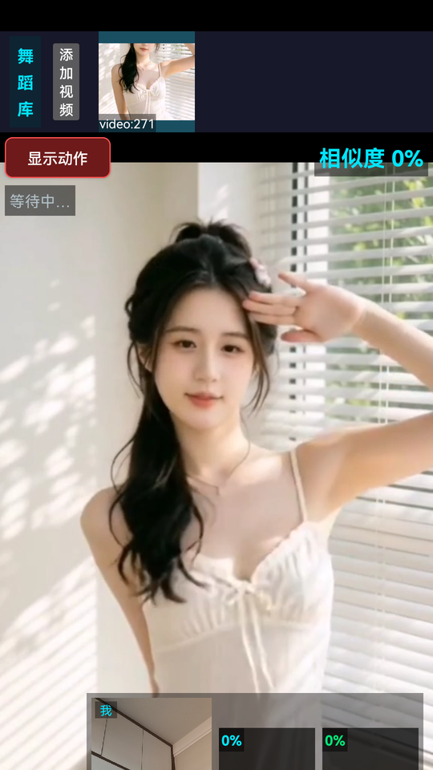
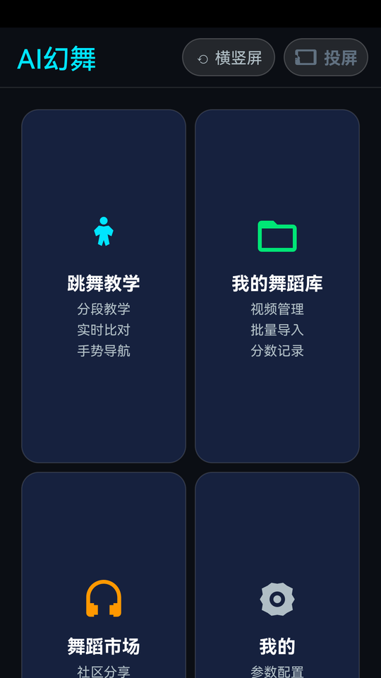
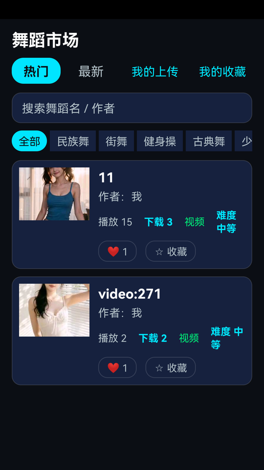
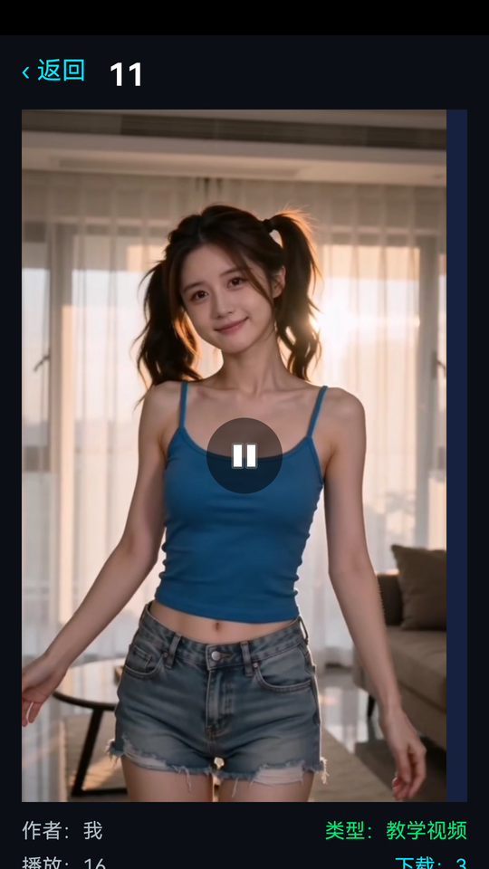
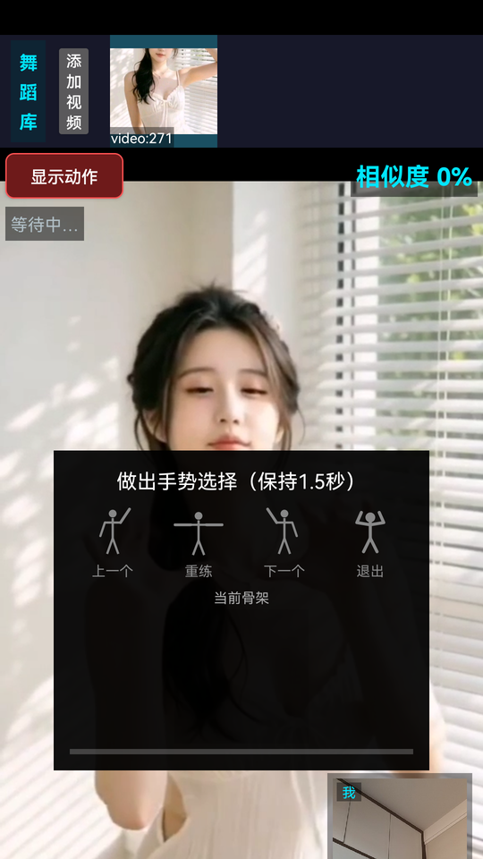
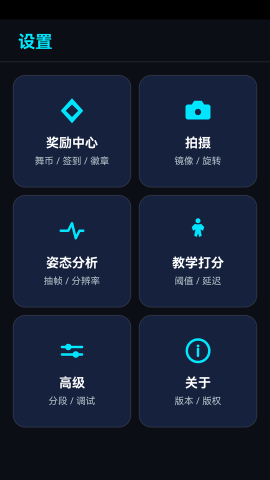
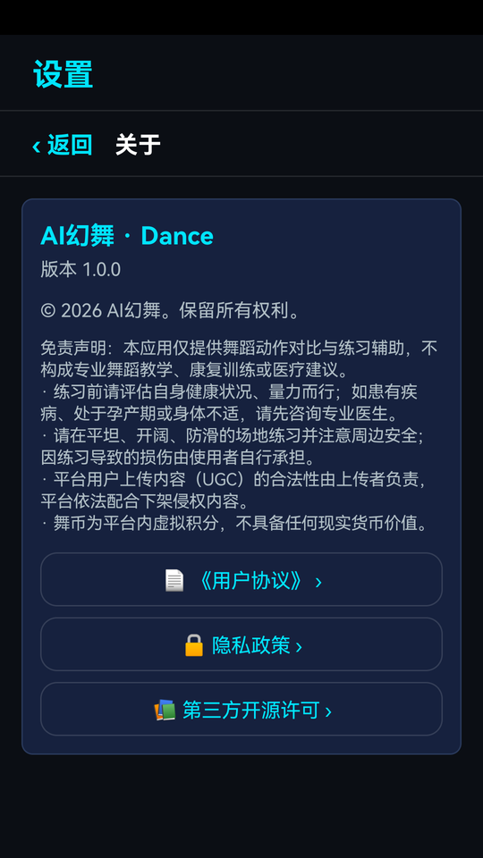

<div align="center">

# AI幻舞 · AI Huanwu

**把手机架起来，摄像头就是你的舞蹈教练。**

跟着教学视频跳，App 实时看着你的动作，逐帧比对后告诉你现在几分、哪个部位没跟上。

[](LICENSE)
[](#安装要求)
[](https://kotlinlang.org/)
[](https://developers.google.com/ml-kit/vision/pose-detection)
[](#下载安装)

[下载安装](#下载安装)　·　[功能](#功能)　·　[界面](#界面预览)　·　[工作原理](#工作原理)　·　[从源码构建](#从源码构建)　·　[常见问题](#常见问题)

</div>

---

## 这是什么

一个人在家练舞，最大的问题是**没人告诉你跳得对不对**。对着镜子看，只能看出"大概像"；
录下来回放，要花时间一帧帧对比，而且下一个动作已经忘了刚才怎么错的。

AI幻舞想解决的就是这件事：

1. 你选一段舞蹈教学视频，它就是你的老师；
2. 手机前置摄像头同时拍着你；
3. App 把「老师的骨架」和「你的骨架」逐帧拆出来，算出动作相似度；
4. 屏幕上实时显示 0–100 分，并提示「注意：右臂再抬高一点」这类具体部位。

不需要可穿戴设备，不需要上传视频到服务器，**所有姿态检测都在手机本地完成**。

<div align="center">



<sub>教学模式：左侧教师视频、右侧实时摄像头画面与骨架，顶部实时相似度</sub>

</div>

---

## 功能

| 模块 | 能力 |
| :--- | :--- |
| **实时跟练** | 摄像头抽帧 → 姿态检测 → 与教师视频逐帧比对，实时相似度 + 最弱部位提示 |
| **双模式** | `DEBUG` 双角骨架浮层（看清自己和老师的骨架差异）／ `FOLLOW` 纯净跟跳 |
| **自动镜像** | 摄像头与视频朝向天然相反，比对前自动做镜像对齐，无需用户手动摆正 |
| **手势控制** | 双手抱头退出、左/右手平举切歌、双臂平举重练——跳到一半不用去点屏幕 |
| **本地舞蹈库** | 批量导入视频、入库自动校验、动作预审、历史评分记录与重玩 |
| **舞蹈市场** | 分享 / 浏览 / 搜索 / 分类 / 下载 / 点赞 / 收藏（后端可选，见[运行模式](#运行模式有无后端都能跑)） |
| **激励体系** | 舞币、每日签到、等级与徽章；上传与被动收益结算 |
| **投屏** | 基于 MediaRouter 的 Presentation 投屏，不依赖 Google Cast SDK |
| **横竖屏双布局** | 首页一键切换，横屏看视频更宽、竖屏单手持机更方便 |
| **参数可调** | 镜像、旋转补偿、抽帧间隔、达标阈值、跟跳延迟，设置页实时生效 |

---

## 界面预览

<table>
<tr>
<td align="center" width="25%"><br><sub>首页</sub></td>
<td align="center" width="25%"><br><sub>舞蹈市场</sub></td>
<td align="center" width="25%"><br><sub>舞蹈详情</sub></td>
<td align="center" width="25%"><br><sub>我的舞蹈库</sub></td>
</tr>
<tr>
<td align="center"><br><sub>教学模式</sub></td>
<td align="center"><br><sub>参数设置</sub></td>
<td align="center"><br><sub>关于与协议</sub></td>
<td align="center"><br><sub>扫码下载</sub></td>
</tr>
</table>

<sub>全部截图为真机拍摄（1080×1920）。App 同时提供横屏与竖屏两套布局。</sub>

---

## 下载安装

<div align="center">

### 最新版本 v1.0.0

[](https://aihuanwu-site-dance-coach-d0gd1yqldc00d1c04.webapps.tcloudbase.com/download.html)

<sub>建议通过上面的**下载页**获取（含安装教程、更新日志与校验值）</sub>

</div>

| 项目 | 信息 |
| :--- | :--- |
| 版本 | `v1.0.0`（versionCode 2） |
| 文件大小 | 32,310,543 字节（约 30.8 MB） |
| 安装要求 | Android 5.0（API 21）及以上 |
| 更新时间 | 2026-10-07 |
| 下载页面 | `https://aihuanwu-site-dance-coach-d0gd1yqldc00d1c04.webapps.tcloudbase.com/download.html` |
| 直接下载 | `https://aihuanwu-site-dance-coach-d0gd1yqldc00d1c04.webapps.tcloudbase.com/download/AIHuanwu-v1.0.0.apk` |
| SHA-256 | `fe442f1bcf47b9dd1c9b1840bf07d11fe1c9948cf781a9df0c0ac49ac7ea0d89` |

### 手机上扫码

<div align="center">


<sub>扫描打开下载页；也可直接访问上方「下载页面」地址</sub>

</div>

### 安装提示

- 从浏览器下载后，系统会提示「未知来源应用」或「存在风险」——这是所有非应用商店安装的正常提示，不是文件有问题。
- 安装过程可能需要你在设置里允许浏览器「安装未知应用」。
- **微信 / QQ 内置浏览器通常会拦截 APK 下载**，请复制链接到手机自带浏览器打开。
- 下载后可用上面的 SHA-256 校验文件完整性（手机端可用任意哈希工具 App 校验）。

### 安装要求

| 项目 | 要求 |
| :--- | :--- |
| 系统版本 | Android 5.0 及以上 |
| 摄像头 | 前置摄像头（必需，用于动作捕捉） |
| 存储 | 约 200 MB 可用空间（App + 姿态模型 + 舞蹈视频） |
| 网络 | 首次运行需联网下载姿态模型（约十几 MB），之后完全离线可用 |

---

## 工作原理

整个流程可以拆成两条并行的路径，最后在评分环节汇合：

```
        ┌─────────────────────┐        ┌──────────────────────┐
        │   教师（视频）        │        │   用户（前置摄像头）    │
        └──────────┬──────────┘        └───────────┬──────────┘
                   │                               │
         按播放进度取帧                       CameraX 持续抽帧
      MediaMetadataRetriever                ImageAnalysis (YUV → Bitmap)
                   │                               │
           物理旋转到正立                      像素级水平镜像
                   │                               │
                   ▼                               ▼
        ┌─────────────────────┐        ┌──────────────────────┐
        │ PoseDetector A      │        │ PoseDetector B        │
        │ SINGLE_IMAGE_MODE   │        │ STREAM_MODE（带时序）  │
        └──────────┬──────────┘        └───────────┬──────────┘
                   │                               │
            33 个关键点坐标                   33 个关键点坐标
                   │                               │
                   └───────────┬───────────────────┘
                               ▼
                   ┌───────────────────────┐
                   │  canonical 归一化      │  以肩髋中心为原点
                   │  （消解身高/站位/距离） │  以躯干长度为尺度
                   └───────────┬───────────┘
                               ▼
                   ┌───────────────────────┐
                   │ ComparisonEngine      │  骨骼方向向量余弦相似度
                   │ 自动镜像对齐            │  → 0–100 分 + 最弱部位
                   └───────────┬───────────┘
                               ▼
                     实时相似度 + 部位提示
```

三个关键决策，也是踩了很多坑之后定下来的：

**一、两条路径用两个检测器。**
教师侧用独立检测器（单张图模式），用户侧用流式检测器（带时序平滑）。
如果共用同一个检测器，两边交替喂帧会互相污染时序，骨架会抖。

**二、打分比的是「方向」而不是「位置」。**
先以肩髋中心为原点、躯干长度为尺度做归一化，再比较骨骼方向向量的余弦相似度。
这样身高、站位、离镜头远近、分辨率差异全部被消解掉，
一米五的人和一米八的人做同一个动作，都能拿到高分。

**三、坐标系必须自洽，不能"全局统一"。**
姿态检测 SDK 返回的坐标处于「送进去的那张图自己的坐标空间」，
旋转参数只影响内部检测、不改变输出坐标系。所以用户路径和教师路径各自维护自己的正立策略，
而不是简单粗暴地全局统一——这一点做错，骨架会整体横躺或镜像颠倒。

---

## 技术栈

| 项目 | 选择 |
| :--- | :--- |
| 语言 | Kotlin 1.6.21（43 个文件，约 9100 行） |
| Android | compileSdk 30 / minSdk 21 / targetSdk 30 |
| 构建 | Gradle 6.8.3 + Android Gradle Plugin 4.2.2 |
| 摄像头 | CameraX 1.0.2（仅 ImageAnalysis，画面自绘） |
| 姿态检测 | Google ML Kit Pose Detection 18.0.0-beta3（本地推理） |
| 视频播放 | ExoPlayer 2.15.1 |
| 投屏 | AndroidX MediaRouter 1.2.5（Presentation） |
| 异步 | Kotlin Coroutines 1.5.2 |
| UI | Android View 体系（XML 布局 + 横竖两套），无 Compose |

**为什么不用 Compose：** 项目最低支持到 Android 5.0，且需要大量自定义 View（骨架叠加层、双画面布局）。
XML + View 体系在低端机上内存占用更可控，也让横竖屏两套布局可以完全分开维护。

---

## 从源码构建

### 环境要求

- JDK 8（Gradle 6.8.3 + AGP 4.2.2 不支持更高版本 JDK）
- Android SDK Platform 30 + Build-Tools 30.0.2
- 一台 Android 5.0+ 真机（**强烈建议真机**，模拟器无法体现真实的姿态检测效果）

### 构建步骤

```bash
git clone https://github.com/zhaocong1992/DanceCoach.git
cd DanceCoach

# 指向本地 SDK —— 这一步不可省略，local.properties 已被 .gitignore 排除
echo "sdk.dir=/path/to/Android/Sdk" > local.properties

./gradlew assembleDebug
# 产物：app/build/outputs/apk/debug/app-debug.apk
```

安装到设备：

```bash
adb install -r app/build/outputs/apk/debug/app-debug.apk
```

首次构建需要联网下载依赖；首次运行 App 时 ML Kit 会下载姿态模型（约十几 MB），此后完全离线可用。

### 常见构建问题

| 现象 | 原因与处理 |
| :--- | :--- |
| `Cannot lock checksums cache` | Windows 下 Gradle 缓存文件锁。加 `--no-daemon`，并换一个全新的 `--project-cache-dir` |
| `NoClassDefFoundError: androidx.work...` | 本地 SDK 只到 API 30 时需要把 `androidx.work` 锁到 2.6.0（`app/build.gradle` 已处理） |
| `lintVitalRelease` 失败 | 旧 Kotlin 插件读不了新版 stdlib 元数据，已在 `app/build.gradle` 中跳过 |
| `maven.google.com` 超时 | 仓库已统一改为 `dl.google.com/dl/android/maven2/` 并保留镜像兜底 |
| 构建很慢 / 卡在下载 | 换国内镜像，或确认网络能访问 `dl.google.com` |

---

## 运行模式：有无后端都能跑

整个「舞蹈市场」被抽象成 `MarketRepository` 接口，有两个实现：

```
MarketRepoProvider.get(context)
        │
        ├── 已配置云端 ──→ CloudMarketRepository   （HTTP 网关实现）
        └── 未配置   ──→ MockMarketRepository     （内置演示数据）
```

判断依据只有一个：`CloudConfig.enabled()`，也就是「网关地址是否非空」。

**本仓库默认不带任何后端地址，因此 clone 下来就是 Mock 模式**——市场里能看到演示数据、
能完整走通浏览/详情/下载流程，但数据不落库、不跨设备。
教学、评分、本地舞蹈库完全不受影响。

> 这是刻意的设计，不是兜底：让项目在零后端的情况下也能完整开发与演示，
> 也让社区在没有原作者服务器的情况下能把它跑起来。

### 接入自己的后端

在 `local.properties` 里填两项（该文件已被 `.gitignore` 排除，不会误提交）：

```properties
cloud.endpoint=https://your-gateway.example.com/api
cloud.appToken=your-shared-secret
```

也可以走 Gradle 属性：`./gradlew assembleDebug -Pcloud.endpoint=... -Pcloud.appToken=...`。

后端需要实现的契约（详见 `MarketRepository` 接口与 [docs/dance_market_design.md](docs/dance_market_design.md)）：

| 方法 | 语义 |
| :--- | :--- |
| `list(sort, category, keyword, authorId)` | 舞蹈列表，支持排序 / 分类 / 搜索 / 按作者筛选 |
| `get(id)` | 单个舞蹈详情 |
| `upload(req)` | 提交舞蹈元数据，返回带 id 的条目 |
| `reportPlay / reportDownload / reportLike` | 播放、下载、点赞计数（用于被动收益结算） |
| `syncMyUploads(ids)` | 按本地上传 ID 批量结算收益 |
| `getUploadCredential(fileName)` | 换取对象存储的**直传预签名 URL** |
| `putVideo(url, stream)` | 流式 PUT 上传视频，避免大文件 OOM |
| `getFileUrl(fileId)` | 用 fileId 换临时可播放 / 下载 URL |

> 视频采用「预签名直传对象存储」而不是经应用服务器转发，是因为大视频走 HTTP 网关
> 容易撞上体积上限；流式 PUT 还能保证低内存占用。

---

## 项目结构

```
app/src/main/java/com/dancecoach/app/
├── ui/          Activity 与自定义 View
│                Home / Teaching / Library / Settings / ActionReview
│                Market{List,Detail,Upload,MyList} / Cast*（投屏）
│                SkeletonOverlayView（骨架叠加，独立小窗不遮挡画面）
│                OrientationUtil（横竖屏切换）
├── camera/      CameraManager
│                CameraX 抽帧 + YUV→Bitmap + 旋转/镜像 + 预览渲染
├── ml/          PoseExtractor（ML Kit 封装，STREAM / SINGLE_IMAGE 双模式）
│                FrameDumper（调试帧落盘）
├── domain/      PoseData / PoseUtils（归一化）/ ComparisonEngine（余弦相似度）
│                AnalysisManager（动作预审）/ Segmenter / FollowAlongController
│                TeachingController / GestureRecognizer / AppPrefs / LegalTexts
│   └── market/  MarketRepository + Cloud/Mock 双实现 / CloudConfig
│                RewardManager / RewardPrefs / MarketPrefs
│                MarketLibraryBridge（市场 → 本地库）/ DeviceIdProvider
└── data/        VideoCacheManager / VideoValidator（入库校验）
```

资源目录同时维护 `res/layout/`（竖屏，14 个）与 `res/layout-land/`（横屏，10 个）两套布局，
由首页的「横竖屏」按钮切换，偏好持久化在 `AppPrefs`。

---

## 关键实现细节

**YUV 转换必须尊重 stride。**
`YUV_420_888` 的 `rowStride` 常常大于图像宽度（硬件内存对齐填充），`pixelStride` 也不一定为 1。
按「整块 buffer 直接首尾拼接」的写法在没有填充的设备上碰巧成立，换到有对齐填充的机型
（常见于中高端高通 / 联发科设备）就会出现**满屏斜向彩色条纹**，姿态检测直接失效。
当前实现按 `rowStride` 逐行取 Y、按 `pixelStride` 取交错的 V/U 拼成标准 NV21，任何设备都能正确还原。

**CameraX 的预览镜像要自己做。**
Preview 走 GPU 渲染，View 级 `scaleX = -1` 在不少机型上不可靠。
本项目在 ImageAnalysis 阶段用 `lockCanvas()` 做像素级水平镜像，保证送进检测器的就是用户看到的画面。

**`Bitmap.createBitmap` 可能返回源对象。**
当变换矩阵是单位矩阵时，它会直接把 `src` 返回来。如果后台线程随后 `recycle()`，主线程绘制就会崩。
处理方式是判断 `result === src`，是则复制一份。

**双布局绝不能只改一份。**
新增控件时如果只改了 `res/layout/`，横屏下的 `findViewById` 会返回 null，
`lateinit` 强取直接 NPE 闪退。项目的约定是：可选控件一律 `private var x: View? = null` + `?.` 安全调用。

---

## 常见问题

**Q：为什么没有 iOS 版？**
iOS 端需要重写整套摄像头与姿态检测链路，工作量和 Android 起步差不多，目前没有精力。

**Q：第一次打开为什么很慢？**
第一次运行时需要下载 ML Kit 姿态模型（约十几 MB）。下载完成后就完全离线了，之后启动很快。

**Q：为什么我的相似度一直是 0 分？**
按可能性排序：① 姿态模型还没下载完；② 光线太暗或逆光，检测不到人体关键点；
③ 全身没进画面，最好让镜头能看到膝盖以上；④ 穿纯色宽松衣服，与背景对比度太低。

**Q：前置摄像头画面是镜像的，正常吗？**
正常，而且是必须的。镜像之后再和教师视频比对，左右方向才一致。设置页也可以关掉镜像。

**Q：支持平板吗？**
支持。App 有横屏布局，平板会是更舒服的形态。注意平板的前置摄像头位置差异较大，最佳站位需要自己摸索。

**Q：舞蹈市场里为什么是空的 / 数据很奇怪？**
本仓库默认不接后端，市场走本地演示数据。要接真实后端请看[运行模式](#运行模式有无后端都能跑)。

**Q：能只用本地视频吗？**
可以。我的舞蹈库支持从相册批量导入视频，导入后会自动校验、预审，然后就能在教学中使用。

**Q：会不会把我的视频上传？**
不会。姿态检测全部在本地完成，摄像头画面不上传、不保存。只有你主动点「上传到市场」时才会传视频。

---

## 已知限制

1. 首次运行需联网下载姿态模型；此后离线可用。
2. release 包包含全部 ABI 原生库（约 32 MB），后续可按 ABI 拆分瘦身。
3. 打分按播放进度取最近帧对齐，对节奏极快或大幅位移的舞蹈会略有滞后。
4. 舞蹈市场后端不在本仓库内，开源版默认使用演示数据。
5. 当前 targetSdk 为 30，尚未适配 Android 12+ 的分区存储与前台服务行为变更。

---

## 为什么开源

这是一个人的业余项目，从零写到能用花了很久，中间踩的坑大多来自别人的博客和开源代码。
姿态检测这一块，尤其是摄像头 YUV 格式、坐标系、镜像这几件事，
中文资料里的坑特别多，很多示例代码在部分机型上就是错的。

把代码放开，一是希望别人做类似功能时少走点弯路，
二是希望有人能指出我做得不对的地方——尤其是算法部分，我一个人很难验证得全面。

如果你用它做出了自己的版本，或者用它学会了第一支舞，欢迎告诉我。

---

## 参与贡献

欢迎 issue 与 PR。提交前请确认：

- 改动能通过 `./gradlew assembleDebug`；
- 不要提交 `local.properties`、任何 `.jks` / `.keystore` / 密钥；
- 界面改动请**同时**检查 `layout/` 与 `layout-land/` 两套布局的控件对齐；
- 涉及核心算法（姿态归一化、相似度、YUV 转换）的改动请附对比数据。

详细规范见 [CONTRIBUTING.md](CONTRIBUTING.md)，安全问题请参考 [SECURITY.md](SECURITY.md)。

---

## 许可证与品牌

源代码以 **Apache License 2.0** 授权，可自由使用、修改、商用、闭源分发，
需保留版权声明与 [NOTICE](NOTICE)。

**商标与素材不在授权范围内。** 「AI幻舞」名称与标识、应用图标、商店截图、
官网视觉设计均为项目所有，未经许可不得用于衍生产品的发布与推广。
（你可以用这套代码做一个自己的舞蹈 App，但请不要叫它「AI幻舞」、不要用同一套图标。）

第三方组件许可见 [NOTICE](NOTICE)，应用内「关于 → 开源许可」页面展示的是同一份内容。

---

<div align="center">

<sub>AI幻舞 是一款独立开发者作品，用 Kotlin 和无数个夜晚写成。</sub>

<sub>如果它对你有帮助，欢迎点一个 Star。</sub>

</div>
