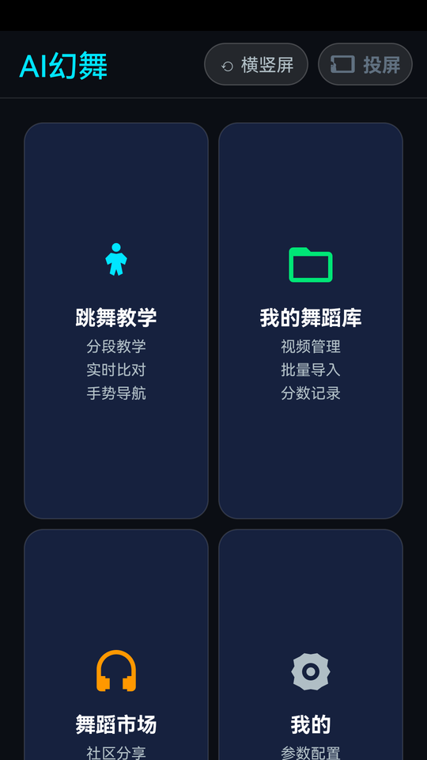
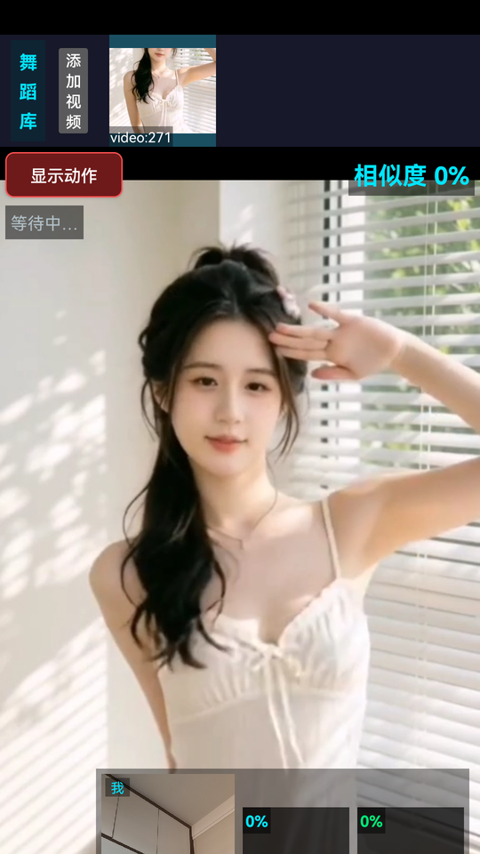
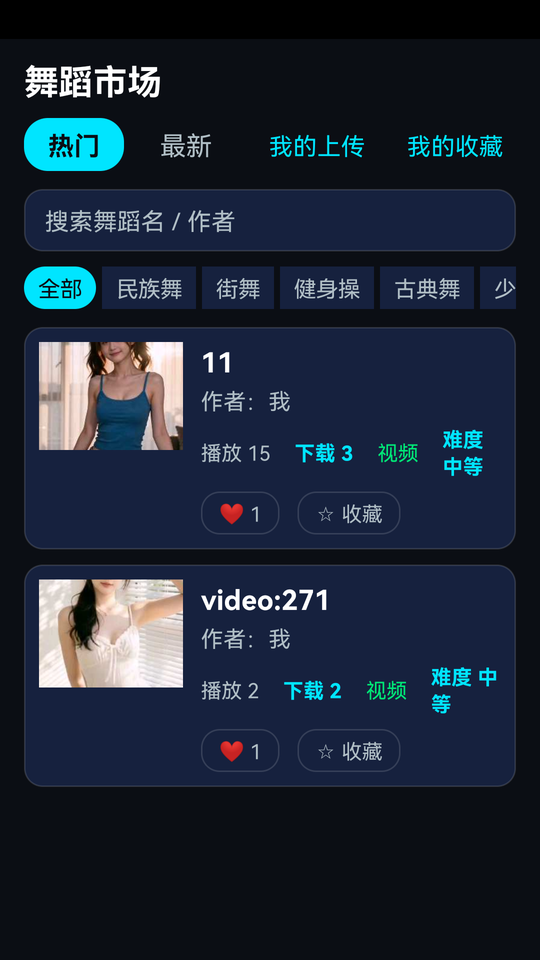
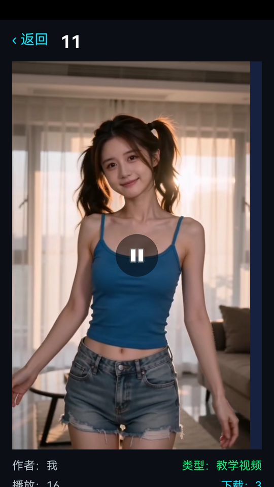
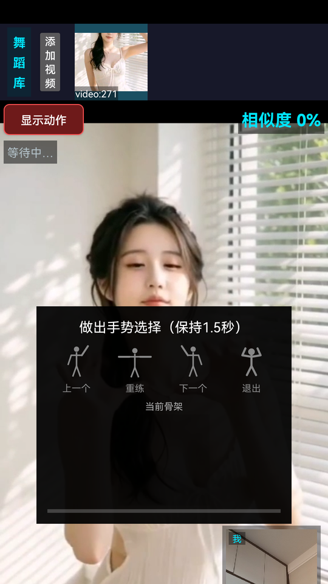
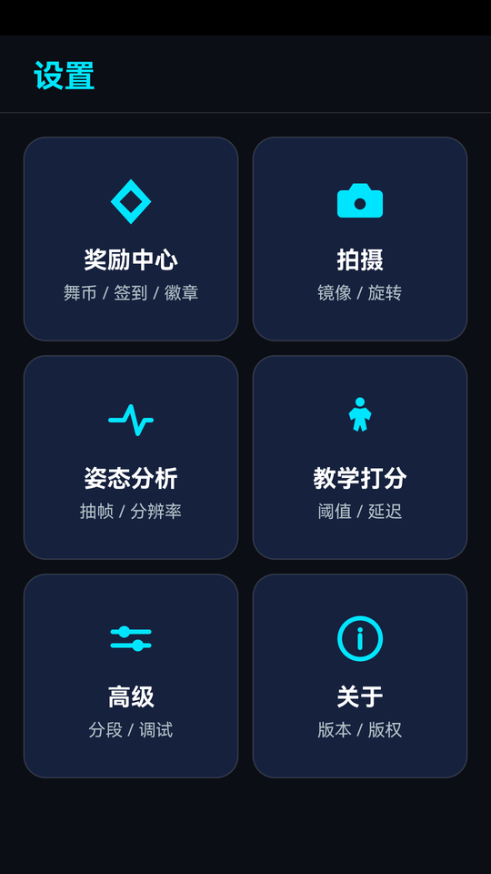

# AI幻舞 · AI Huanwu

> 手机上的 AI 舞蹈教练：一边播放教学视频，一边用前置摄像头实时捕捉你的动作，
> 用骨骼相似度打分，告诉你哪个部位没跟上。

[](LICENSE)
[](#-环境要求)
[](https://kotlinlang.org/)
[](https://developers.google.com/ml-kit/vision/pose-detection)

选一段舞蹈视频，把它当老师。App 用摄像头看你在做什么，把「老师的骨架」和「你的骨架」
逐帧比对，实时给出 0–100 的动作相似度，并指出是手臂、腿部还是躯干没跟上。
不需要可穿戴设备，不需要上传视频，全部在手机本地计算。

**这个仓库是完整的可编译源码**，clone 下来直接能跑出 APK——即使不接任何后端。
（舞蹈市场会使用内置演示数据，教学、评分、本地舞蹈库功能完整可用。）

---

## 界面预览

| 首页 | 教学（实时打分） | 舞蹈市场 |
|:---:|:---:|:---:|
|  |  |  |

| 舞蹈详情 | 我的舞蹈库 | 设置 |
|:---:|:---:|:---:|
|  |  |  |

> 截图来自真机（1080×1920），App 支持横竖屏两套布局。

---

## 功能

| 模块 | 能力 |
|---|---|
| **实时跟练** | 前置摄像头抽帧 → ML Kit 姿态检测 → 与教师视频逐帧比对，实时显示相似度与最弱部位 |
| **教师侧姿态** | 独立检测器按播放时间轴取帧（`MediaMetadataRetriever`），与用户侧互不干扰 |
| **自动镜像** | 摄像头与视频朝向天然相反，比对前自动做镜像对齐，不需要用户手动摆正 |
| **手势控制** | 双手抱头退出、左右平举切换曲目、双手平举重练——不用碰屏幕 |
| **本地舞蹈库** | 批量导入视频、入库自动校验、动作预审、历史评分记录 |
| **舞蹈市场** | 分享 / 浏览 / 搜索 / 分类 / 下载 / 点赞 / 收藏（可后端化，默认本地演示数据） |
| **激励体系** | 舞币、每日签到、等级与徽章；上传与被动收益结算 |
| **投屏** | 基于 MediaRouter 的 Presentation 投屏，不依赖 Google Cast SDK |
| **可调参数** | 镜像、旋转补偿、抽帧间隔、达标阈值、跟跳延迟，均在设置页实时生效 |

---

## 技术栈

| 项目 | 选择 |
|---|---|
| 语言 | Kotlin 1.6.21 |
| Android | compileSdk 30 / minSdk 21（Android 5.0+）/ targetSdk 30 |
| 构建 | Gradle 6.8.3 + Android Gradle Plugin 4.2.2 |
| 摄像头 | CameraX 1.0.2（仅 ImageAnalysis，自绘预览） |
| 姿态检测 | Google ML Kit Pose Detection 18.0.0-beta3（本地推理，模型首次运行自动下载） |
| 视频播放 | ExoPlayer 2.15.1 |
| 异步 | Kotlin Coroutines 1.5.2 |
| UI | Android View 体系（XML + 双布局），无 Compose |

### 为什么不用 Compose

这个项目起步时最低支持到 Android 5.0，且需要大量自定义 View（骨架叠加层、双画面布局）。
XML + View 体系在低端机上内存占用更可控，也让横竖屏两套布局可以完全分开维护。

---

## 快速开始

### 环境要求

- JDK 8（Gradle 6.8.3 + AGP 4.2.2 不支持更高版本 JDK）
- Android SDK Platform 30 + Build-Tools 30.0.2
- 一台 Android 5.0+ 真机（**强烈建议用真机**，模拟器没有可用的姿态检测效果）

### 构建

```bash
git clone https://github.com/<your-account>/aihuanwu-android.git
cd aihuanwu-android

# 指向本地 SDK（这一步不可省略，local.properties 已被 .gitignore 排除）
echo "sdk.dir=/path/to/Android/Sdk" > local.properties

./gradlew assembleDebug
# 产物：app/build/outputs/apk/debug/app-debug.apk
```

安装到设备：

```bash
adb install -r app/build/outputs/apk/debug/app-debug.apk
```

> 首次构建需要联网下载依赖；首次运行 App 时 ML Kit 会下载姿态模型（约十几 MB），
> 之后完全离线可用。

### 常见构建问题

| 现象 | 原因与处理 |
|---|---|
| `Cannot lock checksums cache` | Windows 下 Gradle 缓存文件锁，加 `--no-daemon` 并换一个 `--project-cache-dir` |
| `NoClassDefFoundError: androidx.work...` | 本地 SDK 只到 API 30 时，需把 `androidx.work` 锁到 2.6.0（`app/build.gradle` 已处理） |
| `lintVitalRelease` 失败 | 旧 Kotlin 插件读不了新版 stdlib 元数据，已在 `app/build.gradle` 跳过 |
| `maven.google.com` 超时 | 仓库已统一改为 `dl.google.com/dl/android/maven2/` 并保留镜像兜底 |

---

## 运行模式：有无后端都能跑

整个「舞蹈市场」被抽象成 `MarketRepository` 接口，两个实现：

```
MarketRepoProvider.get(context)
        │
        ├── 已配置云端 ──→ CloudMarketRepository   （HTTP 网关实现）
        └── 未配置   ──→ MockMarketRepository     （内置演示数据）
```

判断依据只有一个：`CloudConfig.enabled()`，也就是「网关地址非空」。

**默认（本仓库不带任何后端地址）就是 Mock 模式**——市场里能看到演示数据、能完整走通
浏览/详情/下载流程，但数据不落库、不跨设备。教学与评分完全不受影响。

### 想接自己的后端？

在 `local.properties` 里填两项即可（该文件已被 `.gitignore` 排除，不会误提交）：

```properties
cloud.endpoint=https://your-gateway.example.com/api
cloud.appToken=your-shared-secret
```

也可以走 Gradle 属性：`./gradlew assembleDebug -Pcloud.endpoint=... -Pcloud.appToken=...`。

后端需要实现的契约（详情见 `MarketRepository` 接口与 `docs/dance_market_design.md`）：

| 方法 | 语义 |
|---|---|
| `list(sort, category, keyword, authorId)` | 舞蹈列表，支持排序/分类/搜索/按作者筛选 |
| `get(id)` | 单个舞蹈详情 |
| `upload(req)` | 提交舞蹈元数据，返回带 id 的条目 |
| `reportPlay / reportDownload / reportLike` | 播放、下载、点赞计数（用于被动收益结算） |
| `syncMyUploads(ids)` | 按本地上传 ID 批量结算被下载/点赞带来的收益 |
| `getUploadCredential(fileName)` | 换取对象存储的**直传预签名 URL**（视频不走应用服务器中转） |
| `putVideo(url, stream)` | 流式 PUT 上传视频，避免大文件 OOM |
| `getFileUrl(fileId)` | 用 fileId 换临时可播放/下载 URL（应对私有读存储） |

> 视频采用「预签名直传对象存储」而不是经应用服务器转发，是因为大视频走 HTTP 网关
> 容易撞上体积上限；流式 PUT 还能保证低内存占用。

---

## 项目结构

```
app/src/main/java/com/dancecoach/app/
├── ui/          Activity 与自定义 View
│                Home / Teaching / Library / Settings / ActionReview
│                Market{List,Detail,Upload,MyList} / Cast*（投屏）
│                SkeletonOverlayView（骨架叠加，独立小窗不遮挡画面）
│                OrientationUtil（横竖屏切换）
├── camera/      CameraManager
│                CameraX ImageAnalysis 抽帧 + YUV→Bitmap + 旋转/镜像 + 预览渲染
├── ml/          PoseExtractor（ML Kit 封装，STREAM / SINGLE_IMAGE 双模式）
│                FrameDumper（调试帧落盘）
├── domain/      PoseData / PoseUtils（归一化）/ ComparisonEngine（余弦相似度）
│                AnalysisManager（动作预审）/ Segmenter / FollowAlongController
│                TeachingController / GestureRecognizer / AppPrefs / LegalTexts
│   └── market/  MarketRepository + Cloud/Mock 双实现 / CloudConfig
│                RewardManager / RewardPrefs / MarketPrefs
│                MarketLibraryBridge（市场 → 本地库）/ DeviceIdProvider
└── data/        VideoCacheManager / VideoValidator（入库校验）
```

资源目录同时维护 `res/layout/`（竖屏）与 `res/layout-land/`（横屏）两套布局，
由首页的「横竖屏」按钮切换，偏好持久化在 `AppPrefs`。

---

## 几个关键实现细节

**坐标一致性是整个流水线的前提。**
ML Kit 返回的坐标处于「送入 bitmap 自身的坐标空间」，`rotationDegrees` 只影响内部检测、
不改变输出坐标系。因此用户路径与教师路径各自维护自己的正立策略，
骨架叠加层用 `transpose` 开关区分来源，而不是全局统一。

**YUV 转换必须尊重 stride。**
`ImageProxy` 的 `YUV_420_888` 里 `rowStride` 常常大于图像宽度（内存对齐填充），
`pixelStride` 也不一定是 1。按「整块内存直接拼接」的写法在老机型上碰巧成立，
换到有填充的机型就会花屏。当前实现按 stride 逐行取 Y、按 pixelStride 取交错的 V/U，
任何设备都能正确出图。

**打分用骨骼方向向量而非坐标点。**
`PoseUtils.canonical()` 以肩髋中心为原点、躯干长度为尺度归一化，
再用方向向量的余弦相似度评分。这样身高、站位、离镜头远近、分辨率都被消解掉，
教师骨架和用户骨架可以直接比。

**无云降级是设计的一部分，不是兜底。**
市场模块从第一天就同时存在 Cloud 与 Mock 两个实现，UI 只依赖接口。
这让项目可以在零后端的情况下完整开发和演示，也方便社区在没有你服务器的情况下跑起来。

---

## 已知限制

1. 首次运行需联网下载 ML Kit 姿态模型；此后离线可用。
2. release 包包含全部 ABI 原生库（约 32 MB），后续可按 ABI 拆分瘦身。
3. 打分按播放进度取最近帧对齐，对节奏极快或大幅位移的舞蹈会略有滞后。
4. 舞蹈市场后端不在本仓库内，开源版默认使用演示数据。
5. 当前目标 SDK 为 30，尚未适配 Android 12+ 的分区存储与精确通知等行为变更。

---

## 参与贡献

欢迎 issue 与 PR。提交前请确认：

- 改动能通过 `./gradlew assembleDebug`；
- 不要提交 `local.properties`、任何 `.jks` / `.keystore` / 密钥；
- 界面改动请同时检查 `layout/` 与 `layout-land/` 两套布局的控件对齐；
- 涉及关键算法（姿态归一化、相似度、YUV 转换）的改动请附对比数据。

---

## 许可证与品牌

源代码以 **Apache License 2.0** 授权，可自由使用、修改、商用、闭源分发，
需保留版权声明与 NOTICE。详见 [LICENSE](LICENSE) 与 [NOTICE](NOTICE)。

**商标与素材不在授权范围内。** 「AI幻舞」名称与标识、应用图标、商店截图、
官网视觉设计均为项目所有，未经许可不得用于衍生产品的发布与推广。
（你可以用这套代码做一个自己的舞蹈 App，但请不要叫它「AI幻舞」、不要用同一套图标。）

第三方组件许可见 `app/src/main/java/com/dancecoach/app/domain/LegalTexts.kt` 中的
「开源许可」条目以及 [NOTICE](NOTICE)。

---

## 关于

AI幻舞是一款独立开发者作品，最初是想解决「一个人在家练舞没人纠正」的问题。
如果你用它做出了自己的版本，或者用它学会了第一支舞，欢迎告诉我。
